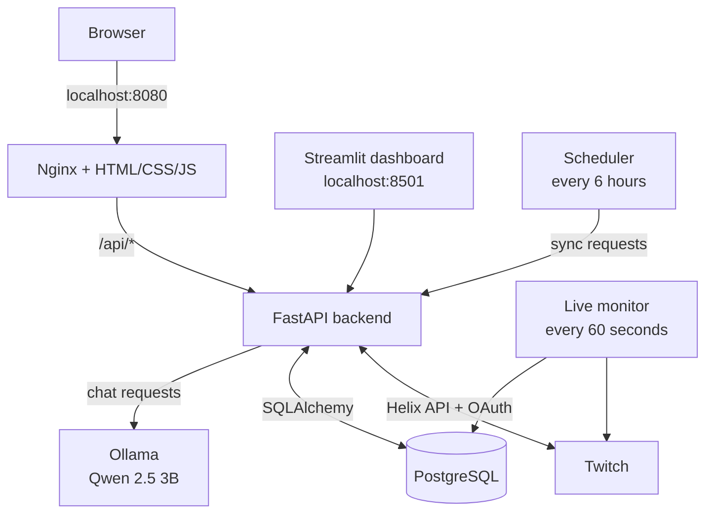

<div align="center">

# 🎮 JoyStream AI

### Twitch analytics powered by Python, PostgreSQL and local AI

**Collect. Visualize. Understand. Improve.**

[](https://www.python.org/)
[](https://fastapi.tiangolo.com/)
[](https://www.postgresql.org/)
[](https://www.docker.com/)
[](https://ollama.com/)


**An independent, self-hosted Twitch analytics platform built for [Joysantalola](https://www.twitch.tv/joysantalola67).**

[Features](#-features) · [Architecture](#-architecture) · [Quick start](#-quick-start) · [API](#-api-overview) · [Roadmap](#-roadmap)

</div>

---

## 📖 About the project

**JoyStream AI** is a personal AI and Big Data portfolio project that brings together Twitch data ingestion, historical analytics, a responsive web dashboard and an AI assistant running **locally** with Ollama.

Instead of relying solely on the statistics displayed in Twitch, the platform periodically collects available data, stores snapshots in PostgreSQL, and helps analyze clips, VODs, live audience samples and channel growth over time.

**The goal:** make data-driven decisions about streaming content while learning practical backend engineering, data pipelines, OAuth, databases, containerization and applied AI.

> **Project scope:** currently designed for one Twitch channel (`joysantalola67`) and local development. It is **not** a hosted public SaaS product.

## ✨ Features

| Area | Capabilities |
| --- | --- |
| **Channel profile** | Twitch display name, description and profile picture |
| **Clips** | Import, store, rank and filter clips; track views and game categories |
| **VODs** | Import archived videos, view statistics and track view history |
| **Game metadata** | Resolve clip game IDs to names; show observed, inferred or unknown VOD categories |
| **Live monitoring** | Poll current stream status and record viewer-count samples while the channel is live |
| **Session analytics** | Aggregate samples by stream and compare games when enough data exists |
| **Community** | Track follower totals and available subscriber metrics over time |
| **Advertising** | View Twitch ad schedule when the channel and OAuth permissions allow it |
| **AI assistant** | Ask questions in Spanish about stored statistics using Ollama + `qwen2.5:3b` |
| **Automation** | Periodic synchronization and continuous live monitoring via dedicated containers |
| **Web dashboard** | Responsive HTML/CSS/JavaScript interface with an Nginx reverse proxy |
| **Testing** | Python `unittest` tests covering AI context preparation |

### Important data limitations

- **Views are not concurrent viewers.** Clip and VOD views are different from live audience samples.
- **VOD categories are not always directly available.** The interface distinguishes categories observed during live-stream samples, inferred from associated clips, and unknown categories.
- **Channel growth is measured from saved snapshots.** A change in follower totals represents *net change*, not necessarily the number of new follows.
- **Unavailable subscriber data is not zero.** Access depends on Twitch permissions and channel eligibility.
- **Ad scheduling is not ad history.** The current integration does **not** count every ad break during a past stream or report advertising revenue.
- **AI analysis is advisory.** The assistant receives stored metrics and can make mistakes; its suggestions are not guarantees or causal conclusions.

## 🛠️ Tech stack

| Layer | Technology |
| --- | --- |
| API | Python, FastAPI, HTTPX, Pydantic |
| Data persistence | PostgreSQL 16, SQLAlchemy, psycopg |
| Main frontend | HTML, CSS, vanilla JavaScript, Nginx |
| Legacy/prototyping dashboard | Streamlit, Pandas |
| Local LLM | Ollama, Qwen 2.5 3B |
| Streaming integration | Twitch Helix API, OAuth 2.0 |
| Infrastructure | Docker, Docker Compose |
| Tests | Python `unittest` and `unittest.mock` |
| Development environment | Windows + WSL2 Ubuntu + Docker Desktop |

## 🏗️ Architecture



### Docker services

The current `compose.yaml` defines **seven services**:

| Service | Purpose | Local URL / access |
| --- | --- | --- |
| `frontend` | Nginx web frontend and API reverse proxy | `http://localhost:8080` |
| `backend` | FastAPI REST API and Twitch/Ollama integrations | `http://localhost:8000` |
| `db` | Persistent PostgreSQL database | Internal Docker network |
| `dashboard` | Previous Streamlit analytics interface | `http://localhost:8501` |
| `scheduler` | Regular sync (configured at 21,600 seconds) | Background service |
| `monitor` | Stream polling (configured at 60 seconds) | Background service |
| `ollama` | Local AI model runtime | Internal Docker network |

PostgreSQL and Ollama use named Docker volumes (`postgres_data` and `ollama_data`) to persist data and models between container restarts.

## 📁 Project structure

```text
JoyStream-AI/
├── backend/
│   ├── app/
│   │   ├── main.py             # FastAPI routes
│   │   ├── twitch.py           # Twitch Helix API
│   │   ├── twitch_auth.py      # User OAuth and token renewal
│   │   ├── database.py         # SQLAlchemy schema
│   │   ├── storage.py          # Persistence and statistics
│   │   ├── analytics.py        # Session / game analytics
│   │   ├── channel_metrics.py  # Followers and subscriptions
│   │   ├── enhancements.py     # Profile, games, VOD metadata, ads
│   │   ├── ai.py               # Local AI integration
│   │   ├── monitor.py          # Live audience polling
│   │   └── test_ai.py          # Unit tests
│   ├── Dockerfile
│   └── requirements.txt
├── frontend/
│   ├── index.html
│   ├── styles.css
│   ├── app.js
│   ├── nginx.conf
│   └── Dockerfile
├── dashboard/                 # Streamlit dashboard
├── scheduler/                 # Periodic synchronization
├── compose.yaml
└── .gitignore
```

## 🚀 Quick start

### 1. Requirements

- Docker Desktop with Docker Compose enabled
- WSL2 + Ubuntu (recommended on Windows), or another Docker-compatible environment
- A Twitch Developer application with a **Client ID** and **Client Secret**
- Enough available memory and disk space to run Ollama and download `qwen2.5:3b`

### 2. Clone the repository

```bash
git clone https://github.com/joysantalola/JoyStream-AI.git
cd JoyStream-AI
```

### 3. Configure environment variables

Create a local `.env` file at the project root:

```dotenv
TWITCH_CLIENT_ID=your_twitch_client_id
TWITCH_CLIENT_SECRET=your_twitch_client_secret
TWITCH_CHANNEL=joysantalola67
POSTGRES_PASSWORD=choose_a_strong_local_password
```

**Never commit `.env` or real credentials to Git.** The existing Twitch integration is currently tailored to the Joysantalola broadcaster ID; adapting it to another channel requires updating the channel-specific configuration in the backend.

In the [Twitch Developer Console](https://dev.twitch.tv/console), register this OAuth redirect URL for your application:

```text
http://localhost:8000/auth/twitch/callback
```

### 4. Build and start the services

```bash
docker compose up -d --build
```

Inspect service status:

```bash
docker compose ps
```

### 5. Download the local AI model

```bash
docker compose exec ollama ollama pull qwen2.5:3b
```

The model is downloaded once and retained in the Ollama Docker volume. No paid LLM API key is required, although local execution uses your computer's resources.

### 6. Authorize the Twitch account

Open this URL in your browser:

**http://localhost:8000/auth/twitch/start**

Log in as the configured broadcaster and approve the permissions required for channel metrics and ads, when available. After authorization, check:

**http://localhost:8000/auth/twitch/status**

The requested OAuth scopes are:

```text
moderator:read:followers
channel:read:subscriptions
channel:read:ads
```

Some metrics may remain unavailable even with the requested scopes, depending on channel eligibility.

### 7. Synchronize and open the dashboard

First import clips and VODs:

```bash
curl -X POST http://localhost:8000/sync
```

To take a snapshot of available community metrics:

```bash
curl -X POST http://localhost:8000/channel/sync
```

Then open:

| Application | URL |
| --- | --- |
| **Modern web dashboard** | http://localhost:8080 |
| **Interactive API docs (Swagger)** | http://localhost:8000/docs |
| **Streamlit dashboard** | http://localhost:8501 |
| **Health check** | http://localhost:8000/health |

**Note:** the scheduler also runs periodic synchronization, so you do not need to call the synchronization endpoints every time.

## 🔌 API overview

All routes below are served by FastAPI on port `8000`. The main frontend accesses the API through the Nginx `/api/` reverse proxy.

| Method | Endpoint | Description |
| --- | --- | --- |
| `GET` | `/health` | Check API status |
| `GET` | `/twitch/channel` | Public channel profile |
| `GET` | `/twitch/clips` | Retrieve current Twitch clips |
| `GET` | `/twitch/videos` | Retrieve Twitch archived videos |
| `POST` | `/sync` | Import clips and VODs into PostgreSQL |
| `GET` | `/db/clips` | Stored clips |
| `GET` | `/db/videos` | Stored VODs |
| `GET` | `/stats` | Database statistics |
| `GET` | `/history/clips` | Clip view snapshots |
| `GET` | `/history/videos` | VOD view snapshots |
| `GET` | `/growth/clips` | Clip growth calculations |
| `GET` | `/growth/videos` | VOD growth calculations |
| `GET` | `/twitch/live` | Current stream status |
| `GET` | `/streams/history` | Live audience samples |
| `GET` | `/analytics/sessions` | Aggregated stream sessions |
| `GET` | `/analytics/games` | Game-based live analytics |
| `GET` | `/channel/current` | Current community metrics |
| `POST` | `/channel/sync` | Save community metrics snapshot |
| `GET` | `/channel/history` | Community growth history |
| `GET` | `/enhanced/catalog` | Profile, clip games and VOD category evidence |
| `GET` | `/enhanced/ads` | Available Twitch advertising schedule |
| `POST` | `/ai/analyze` | Ask the local AI assistant |
| `GET` | `/auth/twitch/start` | Start Twitch OAuth |
| `GET` | `/auth/twitch/status` | Check whether user tokens are stored |

### Example: ask the local AI

```bash
curl -X POST http://localhost:8000/ai/analyze \
  -H 'Content-Type: application/json' \
  -d '{"question":"Analiza mis clips y dime qué puedo mejorar."}'
```

The assistant is instructed to distinguish measured facts from hypotheses, not invent missing statistics, and clearly state relevant data limitations.

## 🗄️ Data collection and storage

The application stores several types of data:

- **`clips` / `videos`:** current stored content metadata and view counts.
- **`view_history`:** time-stamped view-count snapshots for clips and VODs.
- **`stream_samples`:** observed audience counts, games and timestamps during live broadcasts.
- **`channel_metrics`:** time-stamped follower totals and available subscriber figures.
- **`oauth_tokens`:** Twitch user authorization credentials for protected endpoints.

The enrichment API resolves game names and links some VODs to evidence from observed live sessions or associated clips; the category may still remain unknown. The metadata enrichment does not imply that every VOD has a definitive game classification.

## 🤖 Local AI: how it works

1. FastAPI gathers statistics and selected content metadata from PostgreSQL.
2. It builds a compact, structured context describing clips, VODs, live sessions and community measurements.
3. The context and a question are sent to **Ollama**, running `qwen2.5:3b` locally.
4. The assistant returns a Spanish-language analysis with conclusions, recommendations and limitations.

**Privacy / cost:** no paid external LLM API is used. Twitch API requests still connect to Twitch, and local AI answers should be verified against the underlying statistics.

## ✅ Tests and troubleshooting

Run the Python unit tests:

```bash
docker compose exec backend python -m unittest app.test_ai -v
```

Useful diagnostic commands:

```bash
# Check running services
docker compose ps -a

# Follow backend logs
docker compose logs --tail=100 backend

# Follow frontend logs
docker compose logs --tail=100 frontend

# Check Python syntax
docker compose exec backend python -m py_compile app/main.py app/ai.py

# Check API availability
curl http://localhost:8000/health
```

Common issues:

| Symptom | What to check |
| --- | --- |
| `Connection reset by peer` from FastAPI | Backend logs; Python import/startup errors |
| `NameError: app is not defined` | Register FastAPI routers **after** `app = FastAPI(...)` |
| `KeyError` when returning AI results | Nested AI context keys and response assembly |
| Streamlit `SyntaxError: expected except or finally` | Indentation of `try` / `except` blocks |
| Twitch `401` / `403` | Token validity, OAuth scopes and channel eligibility |
| Ollama timeout | Model downloaded, container health and available machine resources |

> Avoid `docker compose down -v` unless you intentionally want to remove persisted PostgreSQL and Ollama volumes.

## 🔐 Security considerations

**This repository is a local-development project, not a production-hardened service.**

- Keep `.env`, API secrets and personal access tokens out of Git.
- Keep database and Ollama services on the internal Docker network.
- The current OAuth implementation persists user tokens in PostgreSQL; a production deployment would require encryption at rest and stronger access controls.
- Some API endpoints perform writes or expose channel analytics without application-level user authentication. **Do not expose the API or its reverse proxy publicly as-is.**
- Review permissions, HTTPS, authentication, CORS/reverse-proxy policies, rate limiting and secret management before any public deployment.
- Never include real Twitch or GitHub tokens in screenshots, issues, commits or documentation.

## 🗺️ Roadmap

- [x] Twitch Helix integration for clips, VODs and channel metadata
- [x] PostgreSQL persistence and historical view snapshots
- [x] Scheduled synchronization and live-viewer polling
- [x] Follower/subscriber snapshots and OAuth integration
- [x] Game-category enrichment and ad schedule information
- [x] Responsive HTML/CSS/JavaScript dashboard
- [x] Ollama-powered local analytics assistant
- [x] Initial unit tests
- [ ] Validate the live monitor and session analytics during a real broadcast
- [ ] Add automated integration tests and data-quality checks
- [ ] Strengthen authentication and secret storage before public hosting
- [ ] Add screenshots and a full technical setup/operations guide

> **Not planned for now:** per-stream ad-break event tracking. The current advertising feature reports scheduling data only.

## 👨‍💻 Author

**Oleguer — [Joysantalola](https://www.twitch.tv/joysantalola67)**  
IT Support & Systems Technician · ASIX · AI & Big Data

- **GitHub:** [github.com/joysantalola](https://github.com/joysantalola)
- **Twitch:** [twitch.tv/joysantalola67](https://www.twitch.tv/joysantalola67)
- **Portfolio:** [olegueresteo.es](https://olegueresteo.es)

---

<div align="center">

**Built for learning, experimentation and real-world Twitch analytics.**

*Independent project. Not affiliated with or endorsed by Twitch.*

</div>
