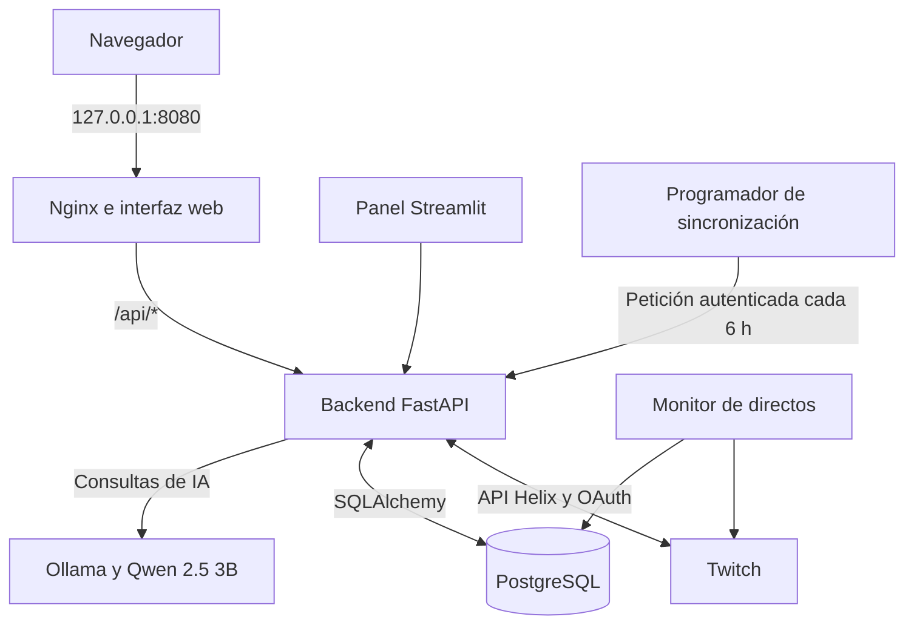

<div align="center">

# 🎮 JoyStream AI

### Analítica de Twitch con Python, PostgreSQL e inteligencia artificial local

**Recopila. Visualiza. Analiza. Mejora.**

[](https://www.python.org/)
[](https://fastapi.tiangolo.com/)
[](https://www.postgresql.org/)
[](https://www.docker.com/)
[](https://ollama.com/)


**Plataforma independiente de análisis de Twitch, desarrollada para el canal [Joysantalola](https://www.twitch.tv/joysantalola67).**

[Características](#-características) · [Arquitectura](#-arquitectura) · [Instalación](#-instalación-local) · [API](#-resumen-de-la-api) · [Seguridad](#-seguridad) · [Próximos pasos](#-próximos-pasos)

</div>

---

## 📖 Acerca del proyecto

**JoyStream AI** es un proyecto personal de portfolio de inteligencia artificial y Big Data que integra la obtención de datos de Twitch, el almacenamiento histórico en PostgreSQL, un panel web y un asistente de IA ejecutado **en local** mediante Ollama.

La plataforma recopila periódicamente los datos disponibles, conserva registros históricos y ayuda a estudiar el rendimiento de clips, vídeos bajo demanda (VOD), directos y evolución de la comunidad.

**Objetivo:** mejorar las decisiones sobre los contenidos del canal mediante datos, a la vez que se ponen en práctica conocimientos de desarrollo backend, APIs, OAuth, bases de datos, automatización, Docker e IA aplicada.

> **Alcance actual:** está configurado principalmente para un único canal, `joysantalola67`, y un entorno de desarrollo local. No es un servicio SaaS público ni una aplicación preparada para exponerse directamente a Internet. Adaptarlo a otro canal puede requerir cambios adicionales en la configuración y en el backend.

## ✨ Características

| Área | Funcionalidades |
| --- | --- |
| **Perfil del canal** | Nombre, descripción e imagen de perfil de Twitch. |
| **Clips** | Importación, almacenamiento, clasificación, filtros, visualizaciones y videojuegos asociados. |
| **Vídeos (VOD)** | Importación de emisiones archivadas, estadísticas e histórico de visualizaciones. |
| **Categorías** | Resolución de identificadores de videojuegos y distinción entre categorías observadas, inferidas o desconocidas. |
| **Monitorización en directo** | Consulta del estado de emisión y registro periódico de muestras de espectadores simultáneos. |
| **Análisis de emisiones** | Agrupación por emisión, comparación de directos y análisis por videojuego y franja horaria. |
| **Comunidad** | Seguimiento de seguidores y, cuando Twitch lo permite, datos de suscripciones. |
| **Publicidad** | Consulta de información sobre la programación de anuncios, según los permisos disponibles. |
| **Joy AI** | Preguntas en español sobre los datos almacenados mediante Ollama y `qwen2.5:3b`. |
| **Automatización** | Sincronización periódica y monitorización mediante servicios independientes. |
| **Panel web** | Interfaz adaptable en HTML, CSS y JavaScript, servida por Nginx. |
| **Pruebas** | Pruebas unitarias de Python para la preparación y el análisis de datos. |

### Novedades de la versión 1.0

- Comparaciones entre **emisiones independientes**, incluso cuando se juega varias veces al mismo título en un día.
- Medias por emisión y medias **ponderadas por muestras**, diferenciadas en las respuestas.
- Análisis de tendencias, horarios, videojuegos y seguimiento de recomendaciones cuando existen datos suficientes.
- Autenticación local para las operaciones sensibles y una credencial interna independiente para el programador de sincronizaciones.
- Mejoras de arranque de los servicios y resolución dinámica del backend desde Nginx.
- **72 pruebas automatizadas superadas** en la instalación de desarrollo utilizada para preparar la versión.

### Limitaciones de los datos

- **Visualizaciones no equivale a espectadores simultáneos.** Las reproducciones de clips y VOD son distintas de las muestras de audiencia de un directo.
- **La categoría de un VOD puede ser incierta.** Se distingue entre información observada durante el directo, inferida a partir de clips y desconocida.
- **El crecimiento de seguidores es neto.** La diferencia entre dos registros no representa necesariamente el número de seguidores nuevos.
- **Un dato no disponible no equivale a cero.** Esto es especialmente importante en las suscripciones, sujetas a permisos y condiciones de Twitch.
- **La programación de anuncios no es un historial de anuncios.** La integración no calcula todos los cortes publicitarios realizados ni los ingresos obtenidos.
- **Las recomendaciones de la IA son orientativas.** Las comparaciones estadísticas no demuestran causalidad ni garantizan un resultado futuro.

## 🛠️ Tecnologías

| Capa | Tecnologías |
| --- | --- |
| API | Python 3.12, FastAPI, HTTPX, Pydantic |
| Base de datos | PostgreSQL 16, SQLAlchemy, psycopg |
| Interfaz principal | HTML, CSS, JavaScript y Nginx |
| Panel anterior y prototipos | Streamlit y Pandas |
| IA local | Ollama y Qwen 2.5 3B |
| Twitch | API Helix y OAuth 2.0 |
| Infraestructura | Docker y Docker Compose |
| Pruebas | `unittest` y `unittest.mock` |
| Entorno de desarrollo utilizado | Windows, WSL2, Ubuntu y Docker Desktop |

## 🏗️ Arquitectura



### Servicios de Docker

El archivo `compose.yaml` define **siete servicios**:

| Servicio | Función | Acceso |
| --- | --- | --- |
| `frontend` | Nginx, interfaz web y proxy inverso de la API | http://127.0.0.1:8080 |
| `backend` | API FastAPI e integraciones con Twitch y Ollama | http://127.0.0.1:8000 |
| `db` | Base de datos PostgreSQL | Red interna de Docker |
| `dashboard` | Panel anterior desarrollado con Streamlit | http://127.0.0.1:8501 |
| `scheduler` | Sincronización periódica, configurada cada 21.600 segundos (6 horas) | Servicio en segundo plano |
| `monitor` | Monitorización de directos, configurada cada 60 segundos | Servicio en segundo plano |
| `ollama` | Ejecución del modelo de IA local | Red interna de Docker |

Los volúmenes de Docker `postgres_data` y `ollama_data` conservan los datos y el modelo entre reinicios. **No ejecutes `docker compose down -v`** salvo que quieras eliminar deliberadamente esos volúmenes.

## 📁 Estructura del proyecto

```text
JoyStream-AI/
├── backend/
│   ├── app/
│   │   ├── main.py                 # Rutas de la API
│   │   ├── twitch.py               # Integración con Twitch
│   │   ├── twitch_auth.py          # OAuth y renovación de tokens
│   │   ├── database.py             # Base de datos
│   │   ├── storage.py              # Almacenamiento y estadísticas
│   │   ├── analytics.py            # Análisis de emisiones
│   │   ├── channel_metrics.py      # Seguidores y suscriptores
│   │   ├── enhancements.py         # Metadatos y publicidad
│   │   ├── ai.py                   # Integración de Joy AI
│   │   ├── auth_local.py           # Autenticación del administrador
│   │   └── test_*.py               # Pruebas automatizadas
│   ├── Dockerfile
│   └── requirements.txt
├── frontend/                      # Interfaz web y configuración de Nginx
├── dashboard/                     # Panel anterior de Streamlit
├── scheduler/                     # Sincronización periódica
├── scripts/
│   └── setup_local.py             # Creación de credenciales locales
├── docs/                          # Seguridad, cambios y lista de comprobación
├── compose.yaml
├── compose.override.yaml
└── .gitignore
```

## 🚀 Instalación local

### 1. Requisitos

- Docker Desktop con Docker Compose, o un entorno compatible.
- En Windows, se recomienda **WSL2 con Ubuntu**.
- Una aplicación creada en la [consola de desarrolladores de Twitch](https://dev.twitch.tv/console), con su **Client ID** y **Client Secret**.
- Memoria RAM y espacio libre suficientes para ejecutar Ollama y descargar el modelo `qwen2.5:3b`.
- Python 3 instalado en el entorno desde el que se vaya a ejecutar el configurador de credenciales.

### 2. Clonar el repositorio

```bash
git clone https://github.com/joysantalola/JoyStream-AI.git
cd JoyStream-AI
```

### 3. Configurar Twitch y PostgreSQL

Crea el archivo **`.env`** en la raíz del proyecto. Ejemplo orientativo, **sin introducir credenciales reales en el repositorio**:

```dotenv
TWITCH_CLIENT_ID=tu_identificador_de_aplicacion
TWITCH_CLIENT_SECRET=tu_secreto_de_aplicacion
TWITCH_CHANNEL=joysantalola67
POSTGRES_PASSWORD=elige_una_contrasena_local_segura
```

> El proyecto está adaptado al canal `joysantalola67`. La variable del canal, por sí sola, no garantiza que funcione correctamente con cualquier otra cuenta: algunas integraciones pueden requerir adaptar identificadores y autorizaciones.

En la consola de Twitch registra esta **URL de redirección de OAuth**, tal como la espera la configuración actual:

```text
http://localhost:8000/auth/twitch/callback
```

### 4. Generar las credenciales del administrador y del programador

Ejecuta:

```bash
python3 scripts/setup_local.py
```

El configurador crea, si todavía no existen, dos archivos privados:

- `.joystream-auth.env`: sal, derivado de contraseña y secreto para firmar las sesiones del administrador.
- `.joystream-internal.env`: token independiente utilizado por el servicio `scheduler` para sincronizar datos.

Se pedirá una contraseña local de administrador en la primera ejecución. **Si los archivos ya existen, el configurador los conserva**; no necesitas volver a ejecutar los instaladores antiguos de desarrollo. No publiques estos archivos ni `.env` en GitHub.

### 5. Construir e iniciar los servicios

```bash
docker compose config --quiet
docker compose up -d --build
docker compose ps
```

Descarga el modelo de IA:

```bash
docker compose exec ollama ollama pull qwen2.5:3b
```

La descarga se realiza una vez y el modelo queda almacenado en el volumen de Ollama. No necesitas contratar una API de IA de pago para generar las respuestas locales.

### 6. Autorizar Twitch mediante OAuth

Abre en el navegador:

**http://localhost:8000/auth/twitch/start**

Inicia sesión con la cuenta que tenga los permisos necesarios y autoriza la aplicación. Para consultar el estado de la autorización:

**http://localhost:8000/auth/twitch/status**

Los permisos solicitados en la integración original son:

```text
moderator:read:followers
channel:read:subscriptions
channel:read:ads
```

Algunos datos pueden seguir sin estar disponibles, aunque se hayan concedido permisos, según las condiciones y características del canal.

### 7. Entrar en el panel y sincronizar

Abre **http://127.0.0.1:8080/** y, cuando sea necesario, introduce la contraseña local del administrador.

La sincronización de vídeos y clips, la actualización de comunidad y el análisis de Joy AI se realizan desde el panel con una sesión autenticada. **Las llamadas `POST` sin autenticación a `/sync`, `/channel/sync` y `/ai/analyze` deben recibir un error `401`.**

El servicio `scheduler` ejecuta la sincronización periódica con su propio token interno, sin tener que iniciar sesión en el navegador.

| Aplicación | Dirección |
| --- | --- |
| Panel web principal | http://127.0.0.1:8080 |
| Documentación interactiva de la API | http://127.0.0.1:8000/docs |
| Panel anterior de Streamlit | http://127.0.0.1:8501 |
| Comprobación de estado | http://127.0.0.1:8080/api/health |

> **Nota sobre la instalación:** los pasos anteriores describen la configuración prevista y están basados en la instalación local del proyecto. Antes de declarar la instalación desde cero completamente validada, hay que comprobarla en un clon limpio, sin reutilizar los archivos privados ni los volúmenes ya existentes.

## 🔌 Resumen de la API

FastAPI sirve las rutas en el puerto `8000`. La interfaz principal las utiliza a través del proxy inverso de Nginx, bajo `/api/`.

| Método | Ruta | Descripción |
| --- | --- | --- |
| `GET` | `/health` | Comprueba el estado de la API. |
| `GET` | `/twitch/channel` | Consulta el perfil del canal. |
| `GET` | `/twitch/clips` | Consulta clips de Twitch. |
| `GET` | `/twitch/videos` | Consulta vídeos archivados de Twitch. |
| `POST` | `/sync` | Importa clips y vídeos en PostgreSQL. **Requiere autenticación.** |
| `GET` | `/db/clips` | Recupera clips almacenados. |
| `GET` | `/db/videos` | Recupera vídeos almacenados. |
| `GET` | `/stats` | Obtiene estadísticas de la base de datos. |
| `GET` | `/history/clips` | Consulta históricos de visualizaciones de clips. |
| `GET` | `/history/videos` | Consulta históricos de visualizaciones de vídeos. |
| `GET` | `/growth/clips` | Calcula la evolución de clips. |
| `GET` | `/growth/videos` | Calcula la evolución de vídeos. |
| `GET` | `/twitch/live` | Consulta si el canal está en directo. |
| `GET` | `/streams/history` | Recupera muestras de audiencia en directo. |
| `GET` | `/analytics/sessions` | Consulta estadísticas agregadas por emisión. |
| `GET` | `/analytics/games` | Consulta estadísticas por videojuego. |
| `GET` | `/channel/current` | Consulta las métricas recientes de la comunidad. |
| `POST` | `/channel/sync` | Guarda un registro de la comunidad. **Requiere autenticación.** |
| `GET` | `/channel/history` | Consulta el histórico de seguidores y suscriptores. |
| `GET` | `/enhanced/catalog` | Recupera metadatos enriquecidos y evidencias de categorías. |
| `GET` | `/enhanced/ads` | Consulta la información de programación de anuncios disponible. |
| `POST` | `/ai/analyze` | Envía una pregunta a Joy AI. **Requiere autenticación.** |
| `GET` | `/auth/twitch/start` | Inicia la autorización OAuth de Twitch. |
| `GET` | `/auth/twitch/status` | Comprueba el estado de los tokens OAuth. |

### Ejemplo de uso de Joy AI

Abre el panel web, inicia sesión y utiliza el asistente Joy AI. Algunas preguntas posibles:

- «¿Cuántos seguidores tengo actualmente?»
- «Compara mis últimos tres directos».
- «¿Qué videojuego tiene mejor media de espectadores?»
- «¿Qué horario parece funcionar mejor según los registros disponibles?»

La IA debe distinguir los hechos registrados de las hipótesis y advertir de las limitaciones de los datos.

## 🗄️ Recopilación y almacenamiento de datos

El proyecto conserva distintas clases de información en PostgreSQL:

- **`clips` y `videos`**: metadatos y visualizaciones de clips y vídeos.
- **`view_history`**: registros históricos de visualizaciones con fecha y hora.
- **`stream_samples`**: muestras de espectadores, videojuegos y marcas de tiempo durante los directos.
- **`channel_metrics`**: registros históricos de seguidores y datos de suscripciones disponibles.
- **`oauth_tokens`**: credenciales de autorización de Twitch para las operaciones que requieren permisos.

La API de enriquecimiento relaciona videojuegos y emisiones a partir de las evidencias disponibles. No siempre es posible determinar con certeza el videojuego de un vídeo archivado.

## 🤖 Cómo funciona Joy AI

1. FastAPI consulta estadísticas y metadatos seleccionados de PostgreSQL.
2. Python prepara un contexto estructurado con clips, vídeos, directos y métricas de la comunidad.
3. El asistente procesa la pregunta con los cálculos y, cuando corresponde, con **Ollama y `qwen2.5:3b`**, ejecutados localmente.
4. Devuelve un análisis en español, diferenciando resultados medidos, recomendaciones y limitaciones.

**Privacidad y costes:** no se utiliza una API de lenguaje de pago para la generación local de respuestas. La conexión a Twitch sigue necesitando acceso a Internet. Las conclusiones de la IA deben contrastarse con las métricas originales.

## ✅ Pruebas y resolución de problemas

Ejecuta las pruebas unitarias:

```bash
docker compose exec backend python -m unittest discover -s app -p 'test_*.py' -q
```

En la instalación utilizada para preparar esta versión se superaron **72 pruebas**. El número puede cambiar en futuras modificaciones.

Comandos útiles para el diagnóstico:

```bash
# Ver los contenedores
docker compose ps -a

# Consultar los últimos mensajes del backend
docker compose logs --tail=100 backend

# Consultar los últimos mensajes del frontend
docker compose logs --tail=100 frontend

# Comprobar el programador de sincronizaciones
docker compose logs --tail=50 scheduler

# Comprobar la sintaxis de los módulos principales
docker compose exec backend python -m py_compile app/main.py app/ai.py

# Comprobar el estado de la API a través del frontend
curl http://127.0.0.1:8080/api/health
```

| Síntoma | Qué revisar |
| --- | --- |
| `Connection reset by peer` en FastAPI | Registros del backend y errores durante el arranque. |
| `NameError: app is not defined` | Registro de rutas después de crear la instancia de FastAPI. |
| `KeyError` durante una respuesta de IA | Estructura del contexto y preparación de la respuesta. |
| `SyntaxError` en Streamlit | Sangrado de bloques `try` y `except`. |
| Error `401` o `403` de Twitch | Validez de tokens OAuth, permisos y disponibilidad de funciones. |
| Error `401` en una operación sensible del panel | Iniciar sesión con la contraseña local. |
| El programador no sincroniza | Comprobar que existe `.joystream-internal.env` y revisar los registros de `scheduler`. |
| Tiempo de espera agotado en Ollama | Modelo descargado, contenedor activo y recursos disponibles. |

No elimines los volúmenes de PostgreSQL y Ollama para resolver un fallo de forma impulsiva: podrías perder datos o tener que volver a descargar el modelo.

## 🔐 Seguridad

**JoyStream AI v1.0 está diseñado para uso local; no es una plataforma endurecida para producción.**

- Los puertos de la aplicación están vinculados a la interfaz local (`127.0.0.1`) en la configuración actual.
- El inicio de sesión protege las operaciones `POST /sync`, `POST /channel/sync` y `POST /ai/analyze` mediante una sesión local.
- El programador utiliza un token interno independiente, limitado a las operaciones de sincronización.
- Las cookies de sesión están pensadas para HTTP local; **no sustituyen una configuración HTTPS segura** para un despliegue público.
- Algunas rutas `GET` y la API accesible directamente en el puerto local pueden no requerir inicio de sesión.
- Los controles de `Origin` y `Sec-Fetch-Site` son capas adicionales de protección, **no mecanismos de autenticación**.
- `.env`, `.joystream-auth.env` y `.joystream-internal.env` no deben publicarse ni compartirse.
- Los tokens OAuth pueden almacenarse en PostgreSQL; un despliegue público exigiría medidas adicionales, incluido un almacenamiento más seguro de secretos.
- Antes de cualquier publicación en Internet sería necesario revisar HTTPS, acceso de usuarios, permisos, gestión de secretos, políticas del proxy y límites de peticiones.

Consulta [la documentación de seguridad](docs/SECURITY.md).

## 🗺️ Próximos pasos

- [x] Integración con Twitch para clips, VOD y metadatos del canal.
- [x] Persistencia en PostgreSQL e históricos de visualizaciones.
- [x] Sincronización programada y monitorización de espectadores.
- [x] Seguimiento de seguidores y suscripciones disponibles.
- [x] Enriquecimiento de categorías y consulta de programación publicitaria.
- [x] Panel web adaptable.
- [x] Asistente con IA local y comparaciones de emisiones.
- [x] Autenticación local y token interno para el programador.
- [x] Pruebas unitarias de la lógica de análisis.
- [ ] Comprobar la instalación completa en un clon limpio.
- [ ] Ampliar las pruebas de integración y calidad de datos.
- [ ] Mejorar la seguridad antes de considerar un alojamiento público.
- [ ] Añadir capturas de pantalla y completar la guía operativa.

> **Fuera del alcance actual:** reconstruir todos los cortes publicitarios realizados en cada directo o calcular ingresos publicitarios históricos.

## 📋 Documentación de la versión

- [Historial de cambios](docs/CHANGELOG.md)
- [Seguridad](docs/SECURITY.md)
- [Lista de comprobación de publicación](docs/RELEASE_CHECKLIST.md)

La etiqueta `v1.0.0` debe crearse únicamente después de completar las comprobaciones de publicación, incluida la revisión del repositorio y de posibles credenciales incrustadas.

## 👨‍💻 Autor

**Oleguer — [Joysantalola](https://www.twitch.tv/joysantalola67)**  
Técnico de Soporte y Sistemas · ASIX · Especialización en IA y Big Data

- **GitHub:** [github.com/joysantalola](https://github.com/joysantalola)
- **Twitch:** [twitch.tv/joysantalola67](https://www.twitch.tv/joysantalola67)
- **Portfolio:** [olegueresteo.es](https://olegueresteo.es)

---

<div align="center">

**Desarrollado para aprender, experimentar y analizar datos reales de Twitch.**

*Proyecto independiente. No está afiliado a Twitch ni cuenta con su respaldo.*

</div>
